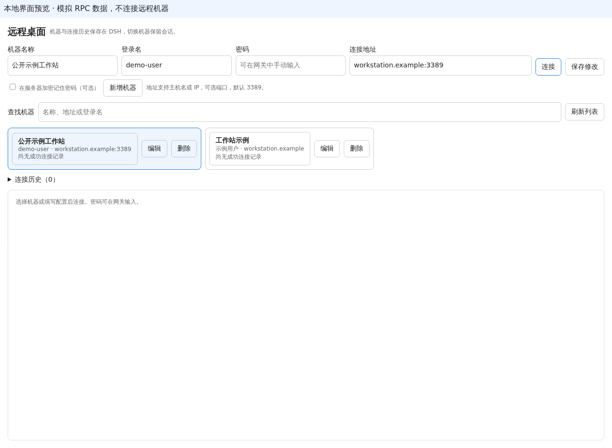

# dsp-rdp：DSH 多机器远程桌面插件

适配 dsh Web `0.2.0-rc.2`，通过 Apache Guacamole `1.6.0` 提供多机器远程桌面。`0.2.0` 的机器配置与完整连接记录保存在本 DSH 实例；不同浏览器访问同一实例时使用相同记录。

表单依次为机器名称、Windows 登录名、密码、连接地址、连接和添加机器。连接地址填写主机名、IPv4 或方括号 IPv6，以及可选端口（默认 3389），例如 `192.168.1.10:3389`。添加只保存配置；连接保存配置后打开网关。密码可留空，在网关的 NLA 登录界面手动输入。只有勾选“在服务器加密记住密码”才会持久保存密码；在已有机器中取消勾选并保存可清除已记住的密码。

机器可按名称、地址或登录名查找、编辑与删除。切换保留已打开的 iframe；点击“断开连接”关闭该嵌入视图。连接历史逐次显示尝试、桌面就绪、断开与失败，支持当前机器筛选、刷新及加载更早记录。错误详情由服务端生成，客户端只上报固定原因代码。

连接状态来自 Guacamole 客户端：只有处于 `CONNECTED`、没有待填登录参数，且桌面宽高均有效时才记录成功。等待 NLA 的连接或零尺寸共享画面不会被标记为成功。独立窗口按钮在桌面就绪后启用，通过当前隧道 UUID 加入同一会话；无法复用时显示错误。保持原页面打开，关闭独立窗口不会关闭嵌入视图。刷新整个宿主页会卸载嵌入视图，重新选择机器时由服务器检查是否有已确认就绪的活动会话可加入。

独立窗口放大、缩小或最大化时自动适配远程画面，并向同一会话请求相应分辨率。更新插件后，刷新 DSH 并重新打开独立窗口，即可启用新版行为。

旧版浏览器入口仍保留在原存储中。同站点连接 ID 匹配服务器导入机器后使用服务器配置；未匹配或外部入口列于“旧版浏览器入口”，可单独打开。

## 界面预览

下图来自真实面板组件的本地预览，使用模拟 RPC 与通用示例数据，展示机器表单、列表及连接历史入口；截图不连接远程机器，也不表示已完成真实远程桌面登录验收。



[查看 375px 窄屏预览](docs/images/panel-preview-mobile.png)

## 构建与安装

已补齐 npm 发布配置。发布成功后可通过 `dsh plugin --profile web add dsp-rdp` 一键安装；实际发布与插件中心展示状态须分别核实。维护者流程见 [npm 发布说明](docs/npm-release.md)。

GitHub 仓库：<https://github.com/andarmworld/dsp-rdp>。通过以下命令安装到 DSH Web profile：

```bash
dsh plugin --profile web add github:andarmworld/dsp-rdp
```

从本地源码构建安装：

```bash
npm ci
npm run typecheck
npm test
npm run build
DSH_HOME=/path/to/isolated/dsh-home dsh plugin --profile web add /absolute/path/to/dsp-rdp
```

服务器端随 DSH 插件加载，客户端通过 DSH 原生 `connection.rpc` 使用现有 `/api` 通道，调用 `rdp/*` 方法；服务端在现有 DSH Web 服务中注册对应的 `/api/rdp/*` 路径。所有机器管理和历史请求复用现有 DSH 服务、地址和认证，不需要独立 API 进程、监听端口或管理接口反向代理。客户端依赖清单包含 `@deepseek-ai/dsh-client-connection`。

## 网关与存储

插件需要运行中的 Guacamole 1.6.0 PostgreSQL 数据源，通过同站点 `/guacamole/` 路径访问；反向代理应支持 WebSocket Upgrade。网关主机须能访问目标机器的 TCP 3389。`gateway/compose.yaml` 提供 Guacamole、guacd 和 PostgreSQL 模板。

插件使用 DSH 原生存储域保存机器与历史，不另建 SQLite 数据库。服务端配置字段如下：

| 字段 | 默认值 | 用途 |
| --- | --- | --- |
| `guacamoleUrl` | `http://127.0.0.1:18081/guacamole` | 仅服务端访问的网关地址 |
| `gatewayUser` | `dshadmin` | 导入和连接时使用的网关用户 |
| `adminUser` | `guacadmin` | 管理连接及权限的本机可信头部身份 |
| `keyFile` | `<DSH_HOME>/secrets/rdp.key` | 独立的密码加密密钥文件 |

可通过 Web profile 的插件配置设置这些字段，例如：

```yaml
- id: ligoo-rdp
  name: dsp-rdp
  config:
    guacamoleUrl: http://127.0.0.1:18081/guacamole
    gatewayUser: dshadmin
    adminUser: guacadmin
    keyFile: /private/dsh-home/secrets/rdp.key
```

网关使用本机可信头部身份；网关服务必须限制为本机受信调用，不能让外部请求自行指定管理身份。密钥文件必须在本仓库及发布包外。服务端导入网关用户已获授权的连接，并管理新建连接的权限。DSH 实例中的操作人员共享本插件数据，请使用 DSH 自身的认证保护访问。

可选的记住密码使用 AES-256-GCM 加密，密钥单独保存并受文件权限保护。列表和历史不返回密码，只有显式连接时交接临时登录密码。密码不会写入浏览器存储、连接 URL 或日志。浏览器仅对同源网关的可见 NLA 密码表单自动提交一次，错误密码不会自动重试。

## 本地界面预览

```bash
npm run preview
```

预览仅绑定 `127.0.0.1:4173`，渲染真实 `RdpPanel`，并明确标记为模拟 RPC 数据。可验证表单、机器列表和历史的布局与交互；不启动管理 API、不代理网关、不连接远程机器，也不包含硬编码密码。真实 RPC、持久化、NLA 与远程桌面验收必须在 DSH 中进行。

## 验证与发布

本地检查覆盖地址校验、加密存储、网关接口契约、真实客户端标识、NLA 与零尺寸画面的就绪判定、表单错误恢复、iframe 保留、历史分页与终态去重、原生 RPC 初始化。实际浏览器需在 375、768、1280px 检查布局，并在输入登录信息后验证真实画面、键盘鼠标、同会话独立窗口与跨浏览器数据恢复。

面板卸载会尝试上报断开记录；浏览器进程被直接关闭或网络中断时，最终请求可能无法送达。

每个发布版本先完成本仓库本地 Git 提交，信息包含版本号与实现内容，并更新 `CHANGELOG.md`。发布包从对应提交构建；记录目标环境、版本、提交哈希和验证结果。未经明确授权不向任何远程环境部署，不推送远端。

## 许可证

本项目采用 [MIT 许可证](LICENSE)，版权归 andarmworld 所有。
